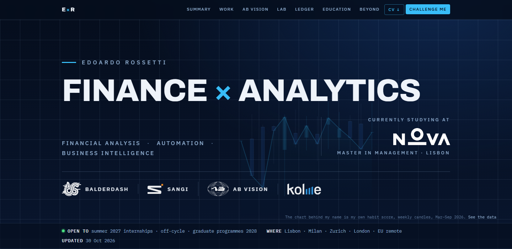

# edoardorossetti.eu

The source of [my personal site](https://edoardorossetti.eu): the long version of my CV, with a receipt next to most
claims and my own habit data behind the hero.



## How it is built

- **One page, no framework.** `site/build.py` joins the HTML parts, inlines the images, and generates the SEO tags,
  JSON-LD, favicons, social card and sitemap. Output: a single `index.html` plus a few static files.
- **Live data.** A nightly n8n job on my server rewrites `ledger.json`, the public slice of my habit tracker that
  draws the candles behind my name. The build inlines a snapshot as fallback.
- **Challenge me.** The form at the bottom posts to `/api/fix`, an n8n webhook. Challenges that hold up are logged
  on the page.
- **Hosting.** Static files served by Caddy on a small VPS I administer. Deploys are checked, backed up and reversible.
- No cookies. Analytics are self-hosted (Umami).

## Editing from my PC

This folder (on my PC, mirrored to `/opt/personal-site` on the server) holds the **source** of the site.
Live files are `/opt/rossettilab/sites/eddy/` (Caddy serves them). Nothing goes live until you run `./upload.sh apply`.

| Path | What it is |
|---|---|
| `site/parts/*.html` | the page, split in parts (`00_head` styles, `10_top` hero/story, `20_abvision`, `30_rest`, `90_script`), joined in name order |
| `site/assets/` | images inlined into the page (logos, school/club photos, headshot, Lab screenshots, `campus.jpg`) and `og.png` (source of the social card `og-hero.jpg`) |
| `site/static/` | copied as is to the site root (`cv/*.pdf`) |
| `site/ledger.json` | snapshot inlined into the page as fallback; the live `/ledger.json` is kept up to date by n8n |
| `site/build.py` | builds `site/dist/` (what goes live) and `site/out/eddy-site.html` (preview). SEO tags, JSON-LD, favicons, sitemap are generated here |
| `docs/` | reference only, never deployed: original deploy notes, n8n workflow steps, the Caddy site block, the Nova Hub brief + screenshots. On my PC only: not in git, except `screenshot.png` |
| `_archive/` | superseded files, never uploaded (`upload.sh` skips every `_*/` folder), not in git. `first-version_2026-10-02/` is the site as it was on 02/10: earlier builds, the old source zip, the raw images, copies of the CVs |

Version number: in the footer, `site/parts/30_rest.html`. Bump it when you change the page.

## Workflow
```
./upload.sh          # send folder, build on the server, show what differs from live (changes nothing live)
./upload.sh apply    # send + build + checks + confirm + backup + deploy + check the site answers 200
./download.sh        # pull the server copy back here (when something was edited on the server)
```
On the server: `/opt/personal-site/deploy.sh status | apply | rollback`. Backups go in `/opt/personal-site-backups/`.
Deploy refuses if `index.html` loses the Umami snippet or the fix-API config, or still has a `{{placeholder}}`.
Deploy also refuses if a live file was edited directly on the server since the last deploy.

Local preview (optional): `pip install pillow && python site/build.py`, then open `site/dist/index.html`.
`dist/` and `out/` are never uploaded: the server always builds its own.

## Never here / never touched
`ledger.json` and `corrections.json` in the live folder: n8n writes them (Fix-this button, ledger updates). Deploy and rollback never overwrite them.
n8n workflows, Caddy config and DNS are not managed here (the Caddy block in `docs/` is a read-only copy).
No `.bak` copies: use git on your PC (`git init` once).
The old source zip in `/opt/rossettilab/sites/personal-site/` is superseded by this folder (kept, untouched).

Windows: run the scripts from Git Bash or WSL (they need `rsync` and `ssh`). Without rsync, `upload.ps1` does the same
job with the tools Windows ships: `powershell -ExecutionPolicy Bypass -File .\upload.ps1` (add `apply` to deploy).
The server address comes from `.deploy.env`, which is not in git (see `.deploy.env.example`).
